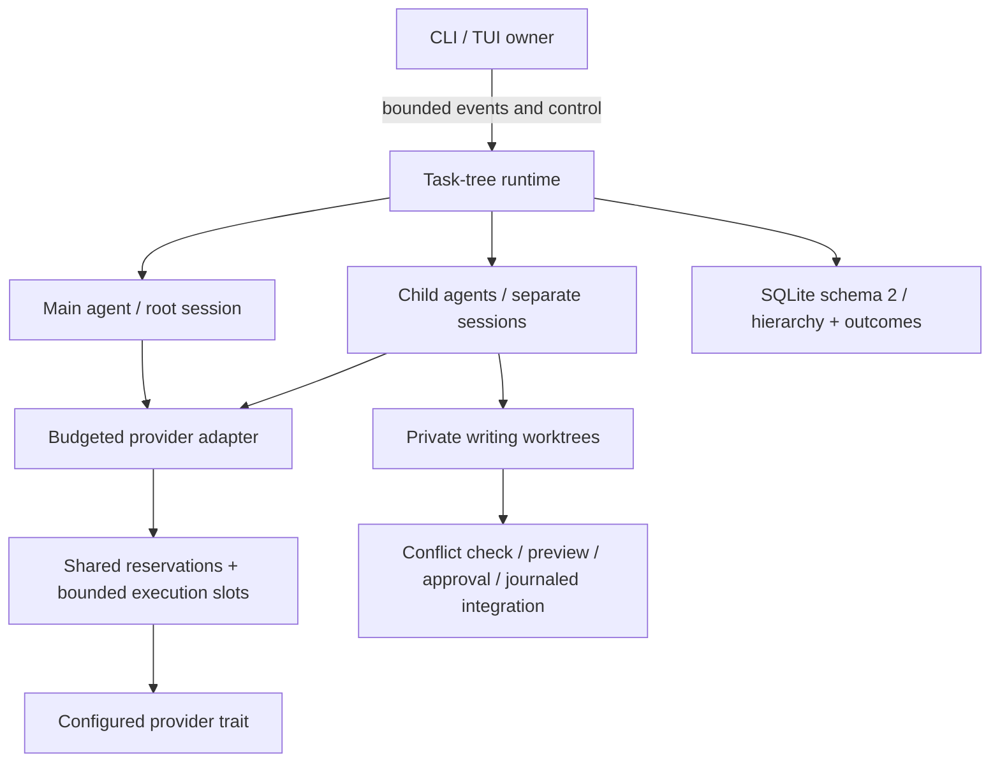

# AETHER architecture

Status: early implementation, not production ready. See docs/IMPLEMENTATION_STATUS.md.

## Ownership and dependencies

```
aether-cli ── aether-tui ── aether-agent ── aether-providers
                                  ├────── aether-tools
                                  └────── aether-storage
All modules depend on aether-core; core depends on none of them.
```

The CLI is the composition root: validated configuration, workspace, database and
provider are assembled once. The TUI owns editor, display and navigation state.
A turn runs in a Tokio task. The agent owns sequential model/tool orchestration.
Tools never call the model or UI. The provider exposes a typed async contract.
SQLite operations run on `spawn_blocking`, never on executor threads.

Presentation receives events over a bounded channel (64). Provider deltas use a
second bounded channel (32), with cancellation-aware backpressure. No idle render
timer: redraw follows input or events. A debounced draft save is asynchronous.
Terminal RAII restores raw mode, alternate screen, mouse and bracketed paste.

## Agent protocol

User message → budget check → streaming completion → validate structured tool
calls → policy → optional once-only approval → execute → durable tool result →
next completion. Maximum steps, total turn deadline, request deadline, output cap
and cancellation bound work. Plain model text is never parsed as shell commands.
No automatic retries of actions or provider requests. ASK/PLAN/REVIEW omit write
and shell tools and independently deny their execution if a provider requests them.
BUILD/DEBUG allow approved writes and commands. Shell always asks, unless denied.

An operation UUID correlates durable lifecycle records; tracing records session
and step, without prompts, credentials or provider bodies. Tool-call IDs correlate
requests, approvals, backups and results. Each message is transactionally committed
before the next external action. An incomplete assistant tool sequence is repaired
with explicit unknown-outcome errors on resume; actions are never replayed.

## Storage and recovery

SQLite schema version 2 (migrating version 1 in place), WAL, synchronous FULL, foreign keys, busy timeout, a
session/event index and FTS5 index. Each event and its search record commit in one
transaction. Draft is stored separately. Streaming chunks commit at 4 KiB and at
the end of a request; an abrupt kill can lose the uncommitted tail, never a committed
message. Partial text is preserved in timeline/export, but never represented as a
completed model message. Fork currently copies history transactionally: correct
isolation, not yet deduplicated shared storage. No restoration command exists.
Original file contents are recorded before model writes for later checkpoint work.

## Trust boundaries

Local endpoint by default, no fallback routing, no telemetry, no plugin execution.
Non-loopback endpoints require explicit remote authorization and HTTPS. Redirects
are disabled so a local endpoint cannot redirect source content to a remote host.
API keys are resolved from an environment variable, never stored by AETHER.
Read/write tools scope paths, reject `..`, outside absolute paths and symlinks, require UTF-8
for reads, cap file size and use checksums to detect ordinary concurrent edits.
Writes use a same-directory temporary file, fsync and atomic replacement; existing
permissions are preserved. A new file never overwrites a concurrently created file.

This is not an OS sandbox. The current path checks and final checksum are not
race-proof against hostile local filesystem mutation. Shell approval grants the
command the full account's access, outside the workspace too. UNIX process groups
are used for cleanup; non-Unix descendant cleanup is not implemented. Extensions
will remain unavailable until capabilities, trust decisions, IPC limits and host
lifecycle have tested implementations. Node/Bun isolation alone is not a sandbox.

## Planned boundaries

Extract context, security, MCP, LSP and plugins only when their real implementation
justifies a crate. Use versioned IPC for extensions; do not mirror all internal Rust
state into JS. MCP 2026-07-28 changes version/transport negotiation relative to older
2025 handshakes: select and test a revision explicitly. ACP is a separate editor ↔
agent protocol, not a replacement for MCP. No compatibility claim exists today.

## Deliberate limitations

Only OpenAI-compatible chat-completions SSE with native structured function tools.
No Anthropic/Gemini adapters, fallback text tools, model routing, automatic context
compaction, pricing guesses, plugins, MCP, LSP, syntax
highlighting or claim of performance parity. Model window is configured by the
user. Heuristic token counts cannot guarantee actual provider limits.

## Phase 2: task-tree runtime

`aether-core::agents` defines profiles/tasks/records/results. `aether-agent` adds a
runtime scheduler, a budgeted provider decorator, explicit control messages, and a
private worktree/integration module. The original agent loop/provider/tools remain
shared by every node; there is no second simulated implementation for subagents.



Root is depth zero. IDs correlate hierarchy, sessions and results. Token/cost/step
reservations occur before provider calls; missing usage is charged conservatively.
A waiting parent releases the slot. Cancellation follows the token tree; finishing
parents cancel unfinished descendants, and the root joins workers before returning.
Concurrent permissions queue in the presentation layer rather than replacing an
unanswered request. A bounded control channel cancels selected live agents.

Writing profiles use committed-HEAD worktrees, while read-only profiles share scope.
The actor's file tools and subagent shell cannot silently target the parent's working
tree. The isolated shell clears inherited environment, hides host home, isolates
network/PID namespaces, and requires Linux bubblewrap. It does not promise cgroup
memory/CPU/PID quotas. User-approved root shell remains unrestricted.

Schema migration preserves version-1 data. On restart, only agents whose root
session lock can be acquired are marked Interrupted; live processes are not falsely
recovered. Historical inspection and approved retained-worktree integration do not
need a new model request. Details and limits: docs/multi-agent.md.

The TUI now uses Ratatui 0.30 and its maintained textarea fork, removing the archived
`paste` transitive dependency instead of suppressing its advisory. The tree and
inspector are implemented; Markdown/syntax, virtualized transcripts, plugins and
MCP/LSP remain deferred. Earlier limitations above are superseded only where this
section and docs/IMPLEMENTATION_STATUS.md explicitly record verified implementation.
