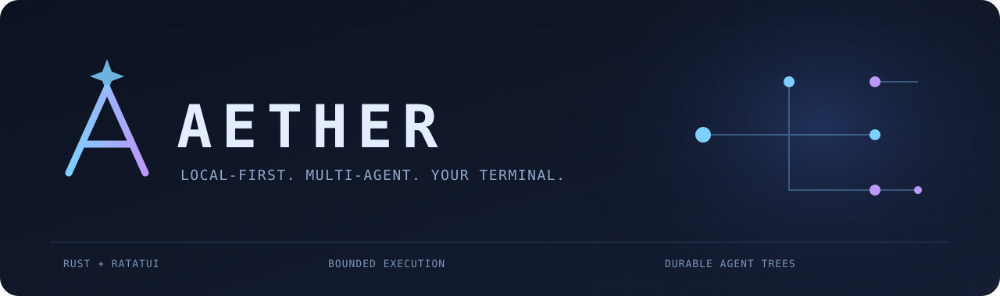
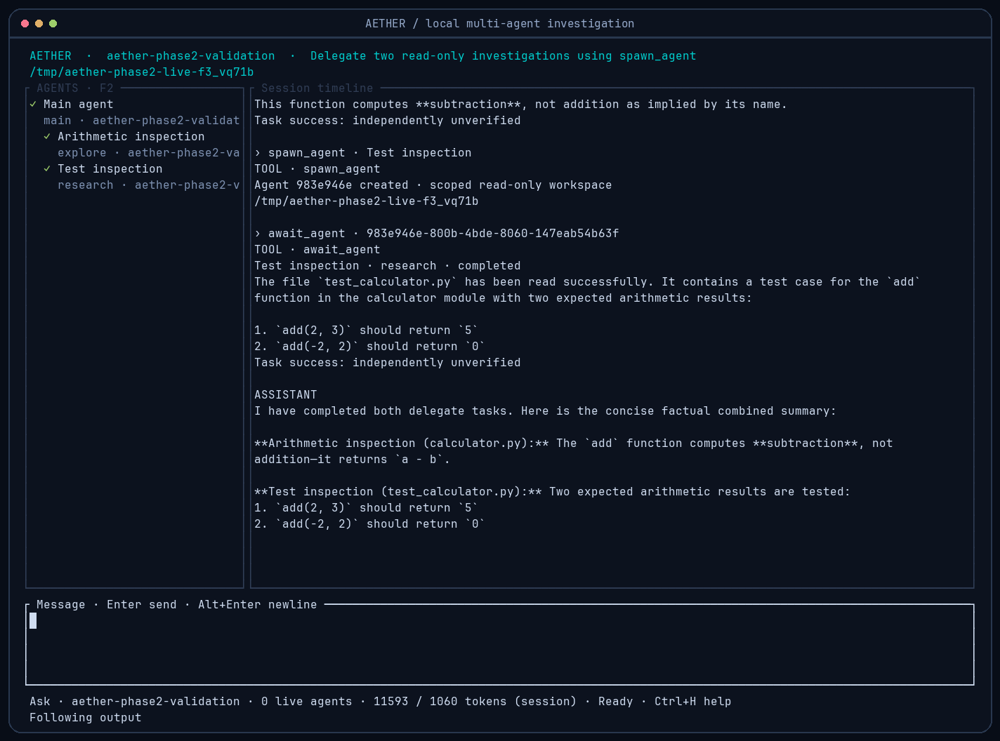
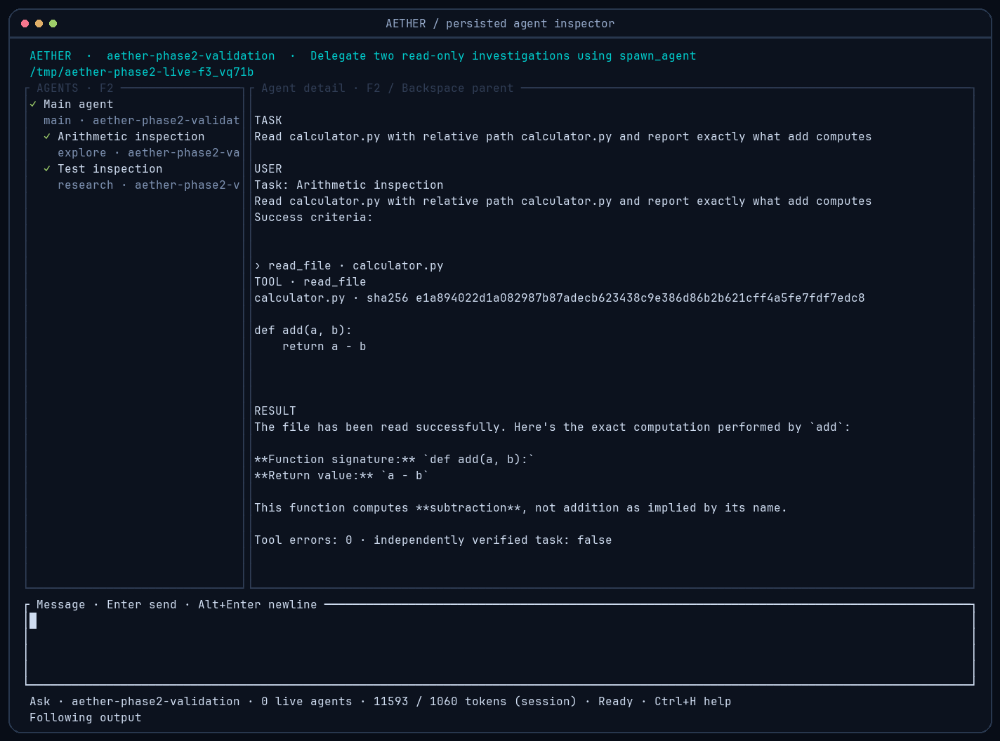

<p align="center">
  
</p>

<p align="center">
  <a href="https://github.com/futureUnd1ground/aether/actions/workflows/ci.yml"></a>
  <a href="LICENSE"></a>
  
  
</p>

<p align="center">
  <b>A terminal coding agent with real subagents, durable histories, and explicit boundaries.</b><br />
  Local models first. Cloud endpoints only when you configure and authorize them.
</p>

<p align="center">
  <a href="#get-started">Get started</a> ·
  <a href="docs/multi-agent.md">Agent engine</a> ·
  <a href="docs/configuration.md">Configuration</a> ·
  <a href="docs/IMPLEMENTATION_STATUS.md">Verified status</a> ·
  <a href="README.ru.md">Русский</a>
</p>

> **Early alpha, not production ready.** The features below are implemented. Plugin compatibility, MCP/LSP, automatic context compaction, and full OS/platform coverage are still future work. There is no claim of outperforming OpenCode.



*An actual local Qwen3.5 2B session: two delegated investigations, independent results, and a combined response. Screenshots capture the real executable's terminal cells; the presentation frame is added by the capture script. [Capture provenance](docs/validation/screenshots.json).*

## What works today

| Capability | Behavior |
|---|---|
| **Real delegation** | `spawn_agent`, `await_agent`, `list_agents`, `cancel_agent`; each child runs the same provider/tool engine with its own context and SQLite session. |
| **Bounded parallelism** | Tokio scheduling, recursive depth/agent limits, per-agent and shared token/step budgets, cancellation propagation. Waiting parents release execution slots. |
| **Inspect every agent** | Interactive tree, persisted messages/tool calls, live status, errors, resource usage, parent navigation, and targeted cancellation. |
| **Isolated edits** | Writing subagents use detached Git worktrees. Integration requires a preview and approval; changed parent files cause a conflict instead of a silent merge. |
| **Local-model streaming** | OpenAI-compatible Chat Completions SSE, structured tools, fragmented stream parsing, finish-reason classification and usage accounting. |
| **Reliable endings** | Empty final responses trigger at most one default summary recovery with tools disabled. Truncated generations never execute their tool calls. |
| **Durable work** | SQLite WAL history, crash recovery, FTS search, session forks/export, drafts, and backwards-compatible schema migration. |
| **Explicit permissions** | Read-only modes, inherited permission ceilings, fresh shell approval, remote-delegation consent, and a sanitized offline Linux sandbox for subagent commands. |

A completed assistant response is **not independent proof that a coding task succeeded**. Agent results preserve tool errors and actual command exit codes, and currently keep `task_success_verified = false`. Actual task acceptance requires independent checks of the resulting files and tests.

## Get started

Requirements: **Rust 1.89+**, Git, a C compiler for bundled SQLite, and an OpenAI-compatible model server. Linux is the exercised platform. Install **bubblewrap** to run subagent shell commands; AETHER never falls back to an unrestricted shell for them.

```bash
git clone https://github.com/futureUnd1ground/aether.git
cd aether
cargo build --locked --release
./target/release/aether config --init
```

Edit the printed config file. Use a real model ID from your server:

```toml
[provider]
base_url = "http://127.0.0.1:1234/v1"
model = "your-loaded-model-id"

[agent]
mode = "ask"
final_response_retries = 1

[permissions]
read = "ask"
write = "ask"
shell = "ask"
```

```bash
./target/release/aether models
./target/release/aether doctor
./target/release/aether                 # read-only TUI
./target/release/aether --mode build    # approved coding and delegation
```

AETHER does not download/start a model or choose a cloud fallback. Start LM Studio, Ollama, llama.cpp, or another compatible server yourself. Native Anthropic/Gemini/Responses protocols are not implemented; hosted **compatible** APIs require explicit remote authorization. [Provider setup](docs/configuration.md).

## Give independent work to agents

For example, ask:

```text
Have an explore agent inspect the authentication module and a review agent
inspect its tests. Await both, compare their evidence, then propose a fix.
```

Built-in profiles: **explore · research · build · debug · test · review**. You can configure their models, tool allowlists, permissions, scope, and budgets, or define your own.

Conservative defaults include two concurrent execution slots, depth two, and eight total agents including the root. Each model request reserves budget before it starts. A configured monetary budget requires explicit token prices; unknown pricing is never assumed free. [Full semantics and examples](docs/multi-agent.md).



### Keyboard controls

| Key | Action |
|---|---|
| `Enter` / `Alt+Enter` | Send / insert a newline |
| `F2` | Focus the agent tree, including on narrow terminals |
| `↑` `↓` / `Enter` | Select / inspect an agent while the tree is focused |
| `Backspace` / `x` | Navigate to the parent / cancel the selected agent |
| `F5` | Refresh the inspected agent's persisted messages |
| `Ctrl+S` / `Ctrl+N` | Browse sessions / create a session |
| `Esc` / `Ctrl+Q` | Cancel the current turn / exit |
| `Ctrl+H` | Help |

Permission requests from concurrent agents queue in order. Approve once with `y`; deny with `n` or `Esc`. Input stays editable during model/tool activity, and drafts persist after a short idle interval.

## Terminal and headless workflows

```bash
aether run --allow-read "Explain the Cargo workspace"
aether run --json "Explain Rust ownership"
aether sessions --search "authentication" --json
aether --session SESSION_ID agents --json
aether agent AGENT_ID                         # metadata + full execution timeline
aether --session SESSION_ID                   # reopen durable history
aether --mode build integrate AGENT_ID        # preview/approve retained isolated edits
aether fork SESSION_ID "Alternative approach"
aether export SESSION_ID > session.json
```

`aether` above is the built binary on your PATH; alternatively use `./target/release/aether`. Noninteractive/JSON runs deny approval requests. `--allow-read` grants scoped reads for that invocation; it grants neither writes nor shell. Nonzero exit codes report execution failure rather than pretending a missing response is success.

## Boundaries worth understanding

- Writing worktrees begin at **committed HEAD**; uncommitted parent changes are excluded. Read-only agents can inspect the current working tree. Integration rejects files that no longer match the base, preserves unrelated changes, journals the original contents, and keeps the worktree for inspection.
- Subagent shell needs working Linux user namespaces and `bubblewrap`. Its environment is sanitized, network is isolated, and only its workspace plus ephemeral temporary directories are writable. Offline builds may need dependencies already cached. Root shell commands are explicitly approved but **not sandboxed**.
- Scoped file APIs reject traversal, outside paths and symlinks. They are not race-proof against a hostile same-user filesystem actor. There is no unrestricted-shell fallback when isolation fails.
- Sessions and exports contain plaintext code/tool output. No telemetry, background provider discovery, or implicit routing is used. Review exports before sharing.
- Long-history virtualization, Markdown/syntax rendering, native provider families, plugins, MCP/LSP and automatic context compaction remain incomplete. Small local models can still make bad tool decisions; budgets contain the work rather than guaranteeing model quality.

Read [SECURITY.md](SECURITY.md) before using the agent on sensitive projects.

## Development and evidence

```bash
cargo fmt --check
cargo clippy --locked --workspace --all-targets -- -D warnings
cargo test --locked --workspace
cargo build --locked --release
python3 scripts/verify_terminal.py
```

Tests cover real tool execution, HTTP streaming, empty finals, recursion, bounded parallelism, budgets, cancellation, migrations, recovery, worktrees, integration conflicts and terminal behavior. Scripted providers live only in tests. Real local-model runs are recorded separately, including a partial failure rather than only selected successes.

- [Implementation status and limitations](docs/IMPLEMENTATION_STATUS.md)
- [Architecture](ARCHITECTURE.md) · [Multi-agent engine](docs/multi-agent.md)
- [Local-model evidence](docs/validation/) · [Reproducible terminal captures](scripts/capture_terminal.py)
- [Benchmark methodology](docs/benchmarks.md) — no comparative speed claims
- [Contributing](CONTRIBUTING.md) · [Roadmap](docs/roadmap.md) · [Changelog](CHANGELOG.md)

## License

MIT. See [LICENSE](LICENSE).
