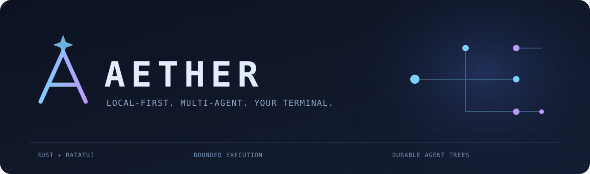
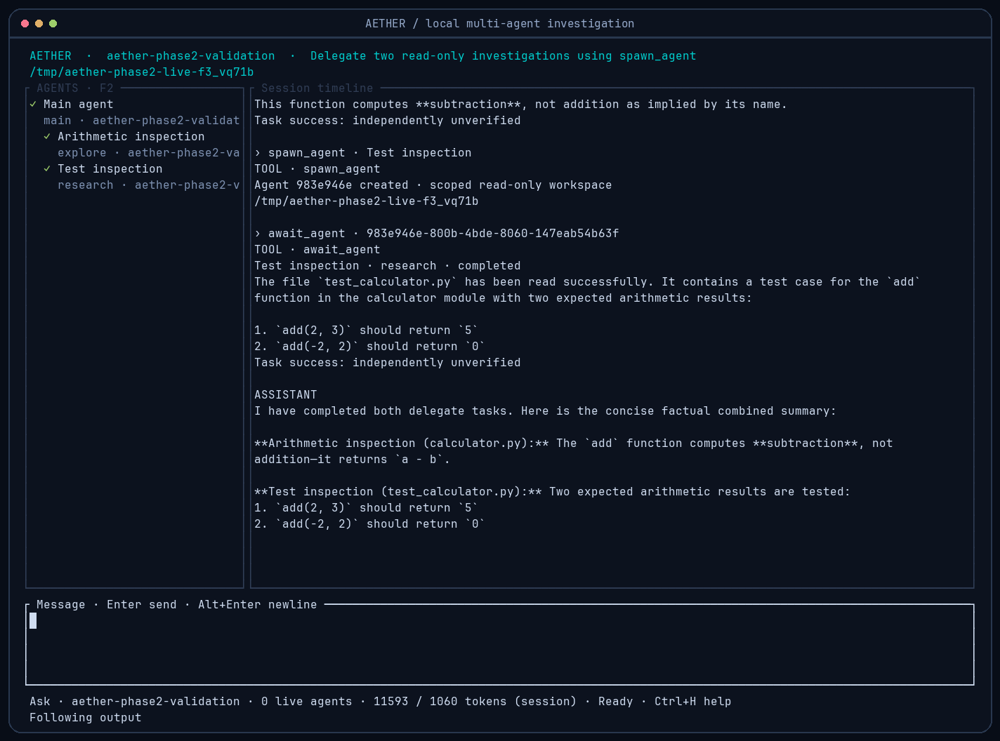

<p align="center"></p>

# AETHER

Локальный AI-агент для программирования в терминале, написанный на Rust. Реальные подагенты, отдельные контексты, история в SQLite и явные разрешения на действия.

**Ранняя alpha-версия.** Это рабочая реализация, но не завершённый production-продукт. Совместимость с плагинами OpenCode, MCP/LSP, автоматическое сжатие контекста и полная поддержка платформ ещё не готовы.



## Уже работает

- Потоковый ответ OpenAI-совместимого сервера; LM Studio/Qwen проверены на реальном запуске.
- `spawn_agent`, `await_agent`, `list_agents`, `cancel_agent`: отдельные сессии и реальные вызовы модели для каждого подагента.
- Параллельность, рекурсивное делегирование, ограничения глубины, количества агентов, шагов и токенов. Денежный лимит требует заданных цен.
- Дерево агентов: просмотр сообщений, инструментов, ошибок, ресурсов и адресная отмена.
- Отдельные Git worktree для записывающих агентов; предварительный просмотр и явное разрешение на интеграцию. Конфликт не перезаписывает пользовательский файл.
- Сохранение истории, черновиков и связей между агентами; восстановление после перезапуска без автоматического повтора действий.
- Одна ограниченная попытка восстановить пустой финальный ответ, с отключёнными инструментами.

Успешный ответ модели не доказывает корректность задачи. Результаты содержат реальные коды завершения команд; независимая проверка задачи автоматически не приписывается.

## Сборка и запуск

Нужны Rust 1.89+, Git, C-компилятор и запущенный OpenAI-совместимый сервер. Проверяемая платформа — Linux. Для shell подагентов нужен `bubblewrap` и работающие user namespaces; небезопасного автоматического обхода нет.

```bash
git clone https://github.com/futureUnd1ground/aether.git
cd aether
cargo build --locked --release
./target/release/aether config --init
```

В созданном конфиге укажите настоящий `provider.model` из своего сервера. По умолчанию используется `http://127.0.0.1:1234/v1`. AETHER не запускает модель и не переключается на облако самостоятельно.

```bash
./target/release/aether models
./target/release/aether doctor
./target/release/aether
./target/release/aether --mode build
```

`Enter` — отправить, `Alt+Enter` — новая строка. `F2` — дерево агентов; стрелки — выбор, `Enter` — открыть, `Backspace` — родитель, `x` — отменить выбранного агента. `F5` обновляет историю. `Esc` отменяет текущий ход, `Ctrl+Q` завершает приложение.

Пример задания: «Поручи explore-агенту изучить модуль авторизации, а review-агенту — его тесты. Дождись обоих, сравни выводы и предложи исправление».

## Важные ограничения

Worktree начинается с **закоммиченного HEAD**: несохранённые в Git изменения родителя туда не входят. Основной shell после подтверждения работает с правами пользователя без песочницы; shell подагентов изолирован. Файловые проверки не защищены от всех гонок с вредоносным процессом того же пользователя. Сессии и экспорты хранят код и вывод инструментов открытым текстом.

[Подробное состояние](docs/IMPLEMENTATION_STATUS.md) · [Движок агентов](docs/multi-agent.md) · [Настройка](docs/configuration.md) · [Безопасность](SECURITY.md) · [English README](README.md)

Лицензия MIT.
